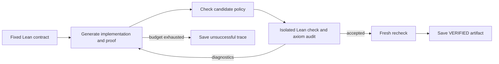

# Lean Verified Agent

A Python controller that asks an LLM for a Lean 4 implementation and correctness
proof, checks them against a fixed specification, and repairs failed attempts
within a resource budget. A successful run saves the accepted Lean artifact;
an unsuccessful run reports `UNSOLVED_WITHIN_BUDGET` and preserves its trace.

This implements the engineering stage of the supplied
[project brief](docs/project-brief.md). It includes ten development contracts,
reviewed reference solutions, four agent strategies, and experiment analysis.
It does not claim a research improvement or include a held-out benchmark yet.



## Quick start

Requirements: Python 3.11 or newer and Docker on Linux x86-64 (the provided
verifier image targets this architecture). The controller has no required
Python dependencies. Run commands from this repository's root.

```bash
python3 -m agent tasks
bash scripts/build-verifier.sh
python3 -m agent demo
```

The demo uses two recorded responses and **real Lean verification**, without an
API key. Its first implementation always returns `some (a - b)`, which fails
the checked-subtraction contract. The second handles underflow and proves the
contract. Expected outcome: `VERIFIED`, two attempts, three Lean checks
(one failed check plus two checks of the successful candidate).

```bash
python3 -m unittest discover -s tests -v
python3 -m agent check-fixtures
```

The initial implementation passed all 56 tests (including real Lean audit
tests), all ten references in Docker, and the repair demo. See the
[validation record](docs/validation.md) for the tested scope.

An optional editable install exposes the same CLI as `lean-agent`:

```bash
python3 -m venv .venv
. .venv/bin/activate
python3 -m pip install -e .
```

The CLI resolves task and Lean assets from the checkout; keep the checkout, or
pass `--root /path/to/lean-verified-agent` when using an installed entry point.

## Live model runs

The client accepts a provider implementing the Chat Completions JSON interface.
Export credentials in your shell; `.env.example` documents the variables and
the CLI does not automatically load `.env` files. The provider must support
`max_tokens` and return text content and token usage. Select a model explicitly.

```bash
export LLM_BASE_URL='https://your-provider.example/v1'
export LLM_MODEL='your-model-name'
read -rsp 'API key: ' LLM_API_KEY
export LLM_API_KEY
python3 -m agent run --task checked_subtraction --strategy repair --max-calls 5
```

Model responses contain exactly two JSON strings:

```json
{
  "implementation": "if b ≤ a then some (a - b) else none",
  "proof": "by\n  constructor\n  · intro a b h\n    simp [candidate, h]\n  · intro a b h\n    have hn : ¬ b ≤ a := by omega\n    simp [candidate, hn]"
}
```

The controller supplies the definition header, theorem statement, namespace,
imports, specification, and acceptance commands. The model can introduce local
helpers with `let rec` and `have`; global helper declarations are intentionally
outside this first version's candidate format.

The verifier transports both bodies as escaped data to a trusted Lean command.
It parses each as exactly one term before constructing the declarations, so
candidate text cannot introduce extra top-level commands. This parsing runs
inside the same isolated verifier as the proof check and dependency audit.

## Strategies and experiments

| Strategy | Behavior |
| --- | --- |
| `one-shot` | One generated implementation and proof |
| `sampling` | Fresh attempts without previous candidates or diagnostics |
| `repair` | Previous candidate and Lean feedback guide the next attempt |
| `planning` | A separate algorithm/invariant plan precedes generation and repair |

```bash
python3 -m agent evaluate --split dev --strategies sampling repair planning \
  --max-calls 5 --max-lean-checks 10 --max-tokens 30000 --max-seconds 300
python3 -m agent analyze results/<experiment-directory> --csv results/summary.csv
```

Sampling and repair use the same caps. Planning calls and tokens consume those
caps too; one-shot remains a descriptive single-call baseline. Each successful
candidate needs a fresh recheck, so the controller reserves two verification
slots before starting an attempt. The token cap includes prompt and completion
usage; preflight estimates are conservative accounting aids rather than a
provider tokenizer or a hard billing guarantee. See
[experiment design](docs/experiments.md) before interpreting comparisons.

Run folders contain prompts, raw responses, candidate fields, rendered Lean
source, diagnostics, and `result.json`. Results record task hashes, calls,
tokens, Lean checks, elapsed time, implementation/proof revisions, and failure
categories. API credentials are never written to traces. Infrastructure or
provider failures report `ERROR`; a failed proof alone does not establish an
incorrect implementation.

## Verification boundary

The Docker runner is the default. It uses a pinned Lean 4.34.1 compiler,
disabled networking, a read-only filesystem, an unprivileged user, dropped
capabilities, and limits on time, memory, processes, and output. Only the
candidate file is mounted. It never falls back to host execution.

Acceptance requires the unchanged contract, policy checks, successful Lean
elaboration, an audit of both implementation and proof dependencies, and a
second successful check in a fresh process. Only the standard logical axioms
`propext`, `Classical.choice`, and `Quot.sound` are accepted. Unfinished proofs,
new axioms, unsafe code, native proof shortcuts, and metaprogramming commands
are rejected. This follows the axiom-checking guidance in Lean's
[proof validation documentation](https://lean-lang.org/doc/reference/latest/ValidatingProofs/).

This is a restricted research prototype. Its lexical policy is conservative;
it is not a full Lean parser or a proof of resistance to arbitrary malicious
Lean/compiler exploits. Two fresh runs use the same Lean kernel, not an
independently implemented proof checker. Trusted tasks and the verifier image
must be reviewed. [Verification details](docs/verification.md) explain the
scope and how to extend it.

If Docker is unavailable, you may explicitly run **reviewed fixture code** on a
local installation of the pinned compiler:

```bash
export PATH='/path/to/lean-4.34.1-linux/bin:'"$PATH"
python3 -m agent demo --backend local --allow-local
python3 -m agent check-fixtures --backend local --allow-local
```

Local execution does not isolate elaboration. Use the default Docker runner for
live LLM candidates.

## Repository layout

```text
agent/          provider clients, prompts, repair policy, controller, CLI
verifier/       candidate policy, source assembly, isolated Lean runner
lean/Trusted/   trusted dependency audit
tasks/          fixed contracts and separate reviewed reference solutions
examples/       recorded failure-and-repair responses
experiments/    matched-budget runs and JSON/CSV analysis
tests/          controller, policy, process, and data tests
docs/           brief, task design, verification, research roadmap
results/        generated traces (ignored by Git)
```

Next steps: add separately audited evaluation contracts, compare repair with
sampling under matched budgets, then evaluate an action policy choosing proof
repair, implementation changes, stronger invariants, or replanning. Audit
larger benchmarks and permit structured global helpers before adding tasks
such as insertion sort that require substantial auxiliary declarations.
