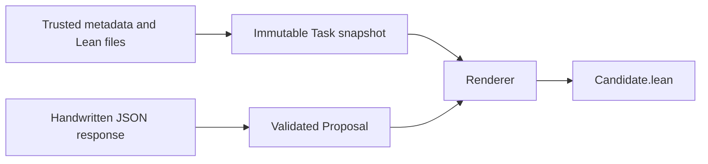

# Exercise 2 — Define tasks and assemble candidate submissions

**Completed and reviewed. Exercise 3 is now current:**
[Run Lean in an isolated worker](../03-sandboxed-runner/README.md).
The original lesson and acceptance tests below remain as a reference.

Your Exercise 1 implementation and proof passed review. This exercise adds the
Python interfaces needed to carry that Lean work through the future agent.
It does not call an LLM yet. We use a handwritten JSON proposal so interface
mistakes can be fixed without paid calls or unreviewed Lean execution.

Your first **ok** requests a review of your work. After passing feedback, a
second **ok** authorizes the next exercise. Stay here if fixes are needed.

## What you are building



The task determines the imports, specification, function signature, declaration
names, and required theorem. The proposal determines only two bodies. The
renderer combines them and changes only the two designated template regions.

The new files you implement are:

| File | Your work |
| --- | --- |
| [agent/task.py](../../agent/task.py) | Implement `Task.load`, `Task.validate_template`, and `Task.digest`. |
| [agent/proposal.py](../../agent/proposal.py) | Implement `Proposal.from_json` and `Proposal.validate`. |
| [agent/render.py](../../agent/render.py) | Implement `render_candidate`. |

The records and function signatures are supplied. The `NotImplementedError`
statements are your starter holes. You may add private helpers, using only the
Python standard library. Keep the public interfaces used by the tests.

## 1. Structured data and immutability

A JSON object becomes a mutable Python dictionary. Type annotations alone do
not validate its values: `Proposal(7, "by rfl")` can be constructed even though
the first field is annotated as `str`. Check values explicitly at the boundary.

A frozen dataclass prevents ordinary attribute assignment:

```python
from dataclasses import dataclass

@dataclass(frozen=True)
class Dimensions:
    width: int
    height: int

size = Dimensions(8, 3)
# size.width = 9 would raise FrozenInstanceError.
```

It does not freeze a list stored inside the record. That is why `Task` uses
tuples for imports/examples, and each `PublicExample` uses a tuple of arguments.
Specification and template contents are immutable strings loaded once.

This prevents accidental mutation in the controller; it is not a security
mechanism against someone who controls the Python process.

## 2. Load the trusted task

Read [task.json](../../tasks/development/checked_subtraction/task.json),
[Specification.lean](../../tasks/development/checked_subtraction/Specification.lean),
and [candidate_template.lean](../../tasks/development/checked_subtraction/candidate_template.lean).
The specification itself remains unchanged from Exercise 1.

Implement:

```python
task = Task.load(repository_root, "checked_subtraction")
```

The metadata file is at `tasks/<split>/<task_id>/task.json`. Support the splits
`development` and `evaluation`; the latter has no tasks yet. Reject invalid
identifiers rather than allowing paths such as `../another_folder`.

Use this mapping when constructing the supplied record:

| Task attribute | Trusted input |
| --- | --- |
| `id`, `title`, `family` | Corresponding metadata strings |
| `specification_module`, `specification_declaration` | `specification.module` and `specification.declaration` |
| `specification_source` | UTF-8 contents of `specification.path`, relative to the repository |
| `implementation_header` | `required_declarations.implementation.header` |
| `implementation_type` | `required_declarations.implementation.signature` |
| `theorem_header` | `required_declarations.correctness.header` |
| `template_source` | UTF-8 contents of `candidate_template`, relative to the repository |
| `permitted_imports` | A tuple from the metadata's import list |
| `public_examples` | A tuple of `PublicExample` records |
| `lean_toolchain` | `environment.lean_toolchain` |
| `metadata_json` | Canonical JSON of the loaded metadata object |

Canonical JSON means a deterministic serialization, such as `json.dumps` with
`sort_keys=True`. Whitespace/key order in the original JSON file should not
change the logical metadata snapshot.

Validate before constructing the record:

- The metadata is an object with schema version 1 and the required nested
  objects/fields. Required strings are nonempty; imports are a list of strings.
- The identifier is a lowercase identifier matching its directory. Editable
  regions are exactly `implementation_body` and `proof_body`.
- Examples have nonnegative integer arguments, excluding booleans, and a
  nonempty expected-result string.
- Source paths are relative, resolve inside the supplied repository root,
  and identify readable files. Normalize malformed/missing task data to a
  useful `ValueError`, rather than an accidental `KeyError` or `AttributeError`.
- The task template passes `validate_template()`.

For path checking, resolve the joined path before checking containment with
`Path.is_relative_to`. A string prefix comparison is insufficient: `/repo-other`
also starts with the characters `/repo`.

Implement `validate_template()` to require:

- Exactly one `{{implementation_body}}` and one `{{proof_body}}` placeholder,
  with no other double-brace placeholders.
- The exact fixed implementation and theorem headers from metadata, each
  occurring once as a declaration line. A changed return type, theorem
  statement, or declaration name must be rejected.
- An import of the specification module and no imports outside
  `permitted_imports`.

These are textual consistency checks. Lean type correspondence and trusted
challenge comparison belong to the later checking exercises.

## 3. Parse a proposal

The initial submission is exactly one JSON object with these two fields:

```json
{
  "implementation_body": "if b ≤ a then some (a - b) else none",
  "proof_body": "by\n  unfold TaskSpec.CheckedSubSpec\n  constructor\n  · intro a b h\n    simp [candidate, h]\n  · intro a b h\n    have hnot : ¬ b ≤ a := by omega\n    simp [candidate, hnot]"
}
```

The strings are complete expression/proof bodies, not `def` or `theorem`
declarations. You can reuse the implementation and proof you wrote in Exercise 1.
The provided [proposal.json](fixtures/proposal.json) is a reviewed worked example.

`Proposal.from_json(text)` must reject malformed JSON, non-object JSON, missing
or extra fields, old field names, non-string values, and empty/whitespace-only
bodies. Keep the original body strings; the renderer handles outer whitespace.

For a smaller worked example of JSON inspection:

```python
import json

data = json.loads('{"count": 3}')
if not isinstance(data, dict) or set(data) != {"count"}:
    raise ValueError("Expected exactly one count field")
if type(data["count"]) is not int:
    raise ValueError("count must be an integer")
```

Implement the supplied `validate()` method as well, so direct construction does
not bypass checks. Each field is limited to `MAX_BODY_BYTES` **UTF-8 bytes**.
Reject whole-word matches from `DISALLOWED_WORDS` and the `#` command marker.
Whole-word matching must allow names such as `endValue`; ordinary `let rec` and
proof-local `have` helpers remain allowed.

For this introductory preflight, the same word restriction applies inside
comments. It is deliberately conservative. Do not build a Lean parser here.
It rejects common declaration/unfinished-proof mistakes, but does not enumerate
every way Lean syntax could be used. Transitive proof dependencies are not
checked by searching for words; that is acceptance-gate work in Exercise 4.

## 4. Render the two bodies

`render_candidate(task, proposal)` returns a string. It must not write files or
run Lean. Call both validation methods, including when a caller constructed
the objects directly.

Strip outer whitespace from each body and prefix **every line** with two spaces.
Preserve indentation already inside the body. For example:

```text
if b ≤ a then           →   if b ≤ a then
  some (a - b)          →     some (a - b)
else                   →   else
  none                 →     none
```

Substitute only the two original template placeholders. Preserve every other
character in the trusted template. The result contains the original import,
the fixed definition header, and the unchanged required theorem header.

Use a single substitution pass rather than replacing the whole evolving string
repeatedly. If an implementation comment contains `{{proof_body}}`, that text
must remain in the implementation; it must not become another replacement site.
`re.sub` with a callback is one standard-library option.

Never change the specification file to make a proposal work. A proposal field
named `specification`, `signature`, or `imports` is invalid input.

## 5. Give the task a stable identity

`Task.digest` should return a 64-character lowercase SHA-256 digest. Hash a
deterministic representation of the stored metadata, specification source,
and template source. Exclude the machine's absolute repository location.

For the hashing mechanism itself:

```python
import hashlib
import json

snapshot = json.dumps({"example": "fixed input"}, sort_keys=True)
digest = hashlib.sha256(snapshot.encode("utf-8")).hexdigest()
```

The same task copied to another directory must have the same digest. Loading
changed trusted source must produce a different digest. An already loaded task
keeps its source and digest even if the files later change on disk. A hash
identifies a snapshot; it does not prove the contract is adequate or the proof
is correct.

## 6. Run the acceptance tests

Run from the repository root with the pinned Python interpreter:

```bash
.venv/bin/python -m unittest discover \
  -s exercises/02-tasks-and-submissions/tests -v
```

**The tests intentionally fail while the starter methods are unimplemented.**
They are kept separate from the existing regression suite. Implement and test
in this order: proposal validation, task loading/template validation/digest,
then rendering. To focus on proposal tests:

```bash
.venv/bin/python -m unittest discover \
  -s exercises/02-tasks-and-submissions/tests -v -k ProposalTests
```

Preserve the earlier environment checks:

```bash
RUN_LEAN_INTEGRATION=1 LAKE_BINARY="$HOME/.elan/bin/lake" \
  .venv/bin/python -m unittest discover -s tests -v
```

The new tests check immutable snapshots, portable identities, malformed inputs,
source-path containment, accidental template changes, body preflight, indentation,
single-pass substitution, and preservation of trusted files.

## 7. Assemble the reviewed example

Once the new tests pass:

```bash
.venv/bin/python -m scripts.exercise02_demo
```

The supplied wiring script writes `runs/exercise02/Candidate.lean` and prints its
task digest. It makes no model call and does not issue a verification verdict.
Inspect the assembled file. For this reviewed example only, check it manually:

```bash
export PATH="$HOME/.elan/bin:$PATH"
lake build
lake env lean runs/exercise02/Candidate.lean
```

The unrendered `candidate_template.lean` is a text template and is not a
standalone Lean program. The completed Exercise 1 learner file remains separate.

## Completion checklist

- [ ] Implement all six starter methods/functions in the three Python modules.
- [ ] All Exercise 2 acceptance tests pass.
- [ ] The fifteen Exercise 1 regression tests still pass with Lean integration.
- [ ] The reviewed proposal assembles and its complete Lean file elaborates.
- [ ] Trusted metadata/specification/template files are not modified by loading
  or rendering; malformed proposals cannot supply a replacement contract.
- [ ] Explain which parts of a task are fixed and which two parts may change.
- [ ] Explain why format/preflight checks and hashes do not establish correctness
  or safe execution of arbitrary Lean.

Say **ok** when finished. I will inspect your implementation, run the checks,
and give feedback. I will wait for a further **ok** before Exercise 3.

The later sandboxed runner and trusted acceptance gate will check proposed Lean
in a restricted environment. This exercise's string assembly and preflight
checks are not a complete semantic protection mechanism.
