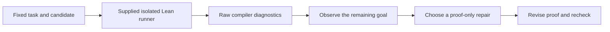

# Exercise 3 — Read Lean feedback and repair a proof

Exercises 1 and 2 passed review. This lesson now focuses on Lean reasoning and
the feedback that guides an agent. The runner, Docker isolation, process limits,
and artifact handling are supplied implementations. You do not need to program
subprocesses, selectors, process groups, Docker commands, or log storage.

Your first **ok** requests review of your proof and check results. After passing
feedback, a second **ok** authorizes Exercise 4. Required fixes stay here. No
model is called in this exercise.

**Exercise 3 passed review.** The learner's proof elaborates, and all diagnostic
cases match their expected outcomes. Written Q&A and reflection requirements
have been removed at the learner's request. The learner's subsequent **ok**
authorized [Exercise 4](../04-trusted-acceptance/README.md), which is now current.

## Your first task

Open [`starter/Candidate.lean`](starter/Candidate.lean). The implementation is
already correct:

```lean
def candidate (a b : Nat) : Option Nat :=
  if b ≤ a then some (a - b) else none
```

Its fixed contract has two obligations:

```lean
(∀ a b, b ≤ a → candidate a b = some (a - b)) ∧
(∀ a b, a < b → candidate a b = none)
```

The starter proof handles the first branch. In the second branch, it introduces
`h : a < b`, then leaves an unsolved goal after simplifying the implementation.
**Change only the proof body of `candidate_correct`.** Keep the import,
implementation, theorem name, and theorem statement fixed. Do not use `sorry`,
`admit`, new axioms, or changed requirements.

First run the supplied check command from the repository root:

```bash
.venv/bin/python -m scripts.exercise03_review
```

It checks reviewed diagnostic examples and your candidate in fresh workers,
retains each source and its compiler logs, and writes
`runs/exercise03/review.json`. The initial learner candidate is expected to
fail. The printed paths identify the full stdout/stderr logs. If the worker
image is unavailable, use the setup command below before retrying.

Read the failing goal. Use `a < b` to establish `¬ b ≤ a`.

Give that fact a name in the proof and use it to simplify the conditional. For
this arithmetic fact, `omega` is available. For using the fact, recall how
`simp [candidate, ...]` selects an `if` branch. Rerun the same check command after
your edit. Retained attempt files let you compare the failed and repaired proof.

## Why this is part of the agent flow



You perform the reasoning steps manually now. Later, an LLM will propose the
candidate and an agent policy will decide what to repair. The same fixed
contract and checking interface remain in place.

The runner records outcomes; it does not diagnose the mathematics for you:

| Observation | What it establishes | Reasonable next step |
| --- | --- | --- |
| Syntax diagnostic with `ELABORATION_FAILED` | This source failed to elaborate. | Inspect the indicated source location and repair syntax. |
| Unsolved goal with `ELABORATION_FAILED` | This proof attempt did not close the displayed obligation. | Inspect hypotheses and target; look for a missing proof step. |
| `TIMEOUT` or `OUTPUT_LIMIT_EXCEEDED` | The check exceeded the configured execution allowance. | Inspect partial diagnostics before deciding what to change. |
| `INFRASTRUCTURE_ERROR` | The check did not provide an ordinary Lean success/failure observation. | Resolve the recorded execution problem; do not infer mathematical failure. |
| `ELABORATED` | Lean successfully processed this source in the recorded environment. | Keep the successful artifact; final acceptance is introduced in Exercise 4. |

Syntax and proof failures can share the same status. Read the diagnostics to
distinguish them. An unsolved goal alone does not establish that an
implementation is wrong. In this starter, the reviewed implementation is
correct and the intended repair is confined to the proof.

## Review evidence

The supplied command retains the source, diagnostics, and check results used
for review. No written answers or reflection file are required.

Do not alter the reviewed failure fixtures to make them pass. They demonstrate
expected diagnostic outcomes. Keep their failure evidence alongside the
successful learner candidate.

## Supplied system interfaces

These interfaces are implemented support code. Read them if you want to see how
Lean connects to Python; your task is to use their evidence and repair the proof.

| Interface | Input | Output / responsibility |
| --- | --- | --- |
| `Task.load(root, "checked_subtraction")` | Repository root and fixed task ID. | Immutable task snapshot and stable identity. |
| `WorkerImage.load(image_report)` | `runs/exercise03/image.json`. | Immutable worker image ID and trusted task/toolchain identity. |
| `DockerLeanRunner(image, ...)` | Worker image, optional Docker executable and limits. | Configured checker; it makes no model calls. |
| `runner.check(task, source, artifact_root=...)` | Fixed task and assembled Lean source string. | `LeanRunResult`, with status, actual version, elapsed time, and report/log paths. |
| `run_bounded(command, timeout_seconds=..., max_output_bytes=...)` | Reviewed host command argument list and limits. | Bounded `ProcessResult`; used internally to manage Docker CLI commands. |
| `docker_create_command(...)` | Validated image, candidate-only input directory, limits, and allowed compiler command. | Restricted Docker argument list. |
| `classify_result(...)` | Process/container observations. | An `Outcome` enum value; no semantic proof verdict. |

The runner stages only `Candidate.lean`, mounts it read-only in a fresh worker,
measures the actual compiler, enforces execution limits, retains bounded byte
logs, and removes the worker. It does not mount the repository or credentials,
call a model, or issue `VERIFIED`. It reports an unavailable Docker environment
as an infrastructure failure and does not fall back to running candidate source
on host Lean.

The retained attempt has `Candidate.lean`, `stdout.log`, `stderr.log`, and
`result.json`. The report records source/task identity, compiler version, limits,
status, and execution/cleanup evidence. The top-level `review.json` summarizes
the latest exercise observations; your **ok** still requests human-readable
review of the implementation and check results.

## Worker setup, if needed

The worker image may already be prepared. If `runs/exercise03/image.json` is
missing or the image is unavailable, build the supplied image with your actual
installed toolchain directory:

```bash
.venv/bin/python -m scripts.prepare_exercise03_image \
  --toolchain "$HOME/.elan/toolchains/leanprover--lean4---v4.34.1"
```

A working local Linux Docker daemon is required. The setup script checks resource
enforcement and stages only the reviewed compiler/project inputs. If using a
standalone Lean installation, pass its actual installation prefix. Image
preparation is a supplied setup command, not an exercise in Docker programming.

## Checks and completion

Your main command is:

```bash
.venv/bin/python -m scripts.exercise03_review
```

The support implementation also has regression tests. They check infrastructure
behavior, and are supplied for confidence rather than as learner coding tasks:

```bash
.venv/bin/python -m unittest discover \
  -s exercises/03-sandboxed-runner/tests -v
RUN_SANDBOX_INTEGRATION=1 .venv/bin/python -m unittest discover \
  -s exercises/03-sandboxed-runner/tests -v
```

Earlier completed exercises remain regression requirements:

```bash
.venv/bin/python -m unittest discover -s tests -v
.venv/bin/python -m unittest discover \
  -s exercises/02-tasks-and-submissions/tests -v
```

- [x] Diagnostic examples produce their expected outcomes.
- [x] Repair only `candidate_correct`'s proof and obtain `ELABORATED`.
- [x] Keep the implementation, theorem statement, and trusted inputs fixed.

Say **ok** when ready for review. After passing feedback, wait and say **ok**
again to advance. Exercise 4 adds trusted final acceptance before autonomous
model generation starts in Exercise 5.
