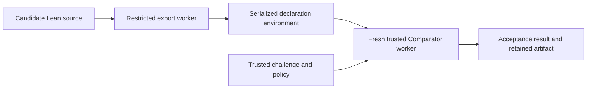

# Exercise 4 — Pass the trusted acceptance checks

Exercises 1–3 passed review. This exercise is practical Lean work: repair three
candidate files until the supplied checker accepts them. There are no written
questions, reflection files, or required prose explanations.

The first **ok** requests implementation review. After passing feedback, a
second **ok** authorizes Exercise 5. No model is called yet.

## What changes in this exercise

Exercise 3 reported whether Lean elaborated a source file. Lean can elaborate a
file that uses an axiom, a helper containing `sorry`, or a theorem about `True`
instead of the required contract. Those sources must not solve the fixed task.

The supplied acceptance checker now checks the declarations against a trusted
challenge. The required function is still:

```lean
candidate : Nat → Nat → Option Nat
```

The required theorem is still:

```lean
candidate_correct : TaskSpec.CheckedSubSpec candidate
```

The checker permits the implementation body to change, while keeping its type,
the theorem statement, and trusted specification fixed. It checks dependencies
transitively, so hiding an unfinished proof inside a helper does not pass.

## First task — replace an axiom with a proof

Open [starter/RemoveAxiom.lean](starter/RemoveAxiom.lean). It contains a correct
implementation and this unproved assumption:

```lean
axiom underflow (a b : Nat) (h : a < b) : candidate a b = none
```

The main correctness theorem uses `underflow`. Lean accepts an axiom as an
assumption, but the acceptance policy does not permit this additional axiom.

Run the focused check:

```bash
.venv/bin/python -m scripts.exercise04_review --only RemoveAxiom
```

Initially it reports `SUBMISSION_REJECTED`. Replace the axiom with a theorem
of the same name and type, and supply its proof:

```lean
theorem underflow (a b : Nat) (h : a < b) : candidate a b = none := by
  -- Your proof goes here.
```

Use your previous exercise's reasoning: from `h : a < b`, derive
`¬ b ≤ a`, then simplify the conditional in `candidate`. Keep the function and
main theorem unchanged. Rerun the focused command until it reports `VERIFIED`.

## Second task — finish a helper proof

Open [starter/FinishHelper.lean](starter/FinishHelper.lean). The main correctness
proof has no `sorry`, but it depends on a helper whose body is `sorry`.

Replace only that unfinished helper body with a real proof. Keep the trusted
contract and implementation unchanged.

```bash
.venv/bin/python -m scripts.exercise04_review --only FinishHelper
```

The initial file elaborates with a warning; final acceptance rejects its
transitive unfinished-proof dependency. Your finished helper must pass.

## Third task — restore the required theorem

Open [starter/RestoreContract.lean](starter/RestoreContract.lean). Its function is
correct, but its theorem proves `True`.

Restore the theorem type to `TaskSpec.CheckedSubSpec candidate` and provide a
proof. Reuse your checked-subtraction proof structure from Exercise 3. Keep the
function, declaration names, and imported trusted specification unchanged.

```bash
.venv/bin/python -m scripts.exercise04_review --only RestoreContract
```

The checker compares the elaborated theorem and its dependencies with the
trusted challenge; a proof of an easier statement does not satisfy that task.

## Check all three repairs

```bash
.venv/bin/python -m scripts.exercise04_review
```

Expected completed output:

```text
[PASS] RemoveAxiom.lean: VERIFIED (expected VERIFIED)
[PASS] FinishHelper.lean: VERIFIED (expected VERIFIED)
[PASS] RestoreContract.lean: VERIFIED (expected VERIFIED)
```

Each attempt retains the proposed source, serialized declaration environment
when available, and `result.json`. The summary is `runs/exercise04/review.json`;
previous sessions remain under `runs/exercise04/learner/`. Completion is based
on the three accepted Lean files and implementation review.

## Optional diagnostic examples

This separate command runs provided teaching fixtures:

```bash
.venv/bin/python -m scripts.exercise04_review --examples
```

These are deliberately separate from your learner files. A `[PASS]` label means
the observed result matched the example's expected result, including an expected
rejection.

| Example | Expected result |
| --- | --- |
| Reviewed complete implementation/proof | `VERIFIED` |
| Direct `sorry` | `SUBMISSION_REJECTED` |
| Helper with `sorry` | `SUBMISSION_REJECTED` |
| Used custom axiom | `SUBMISSION_REJECTED` |
| Changed theorem statement | `SUBMISSION_REJECTED` |
| Same specification name with weakened definition | `SUBMISSION_REJECTED` |
| Missing required theorem | `SUBMISSION_REJECTED` |
| Candidate prints a claimed acceptance verdict | `SUBMISSION_REJECTED` |
| Noncomputable implementation without executable code | `SUBMISSION_REJECTED` |

Do not edit the fixtures or trusted challenge to make an example pass.

## Supplied checking system

The system code and setup are implemented for you:



The first worker compiles the source, exports the relevant declarations, and
runs reviewed execution examples. Only serialized proof data reaches the second
worker. It imports no candidate source or candidate `.olean` file. It uses
upstream Comparator's statement/dependency comparison, axiom checks, and replay
into a fresh Lean kernel. Candidate output cannot grant itself acceptance.

The pinned upstream versions are in
[verification/comparator-lock.json](../../verification/comparator-lock.json).
The upstream revision targets Lean 4.34.0; its source and exporter have been built
and checked with this project's actual Lean **4.34.1** compiler. The bridge
retains Comparator's comparison/replay implementation and replaces its combined
build CLI with these separate Docker stages. It does not run a fake Landrun or
silently fall back to a weaker verifier.

The permitted axiom dependencies are `propext`, `Quot.sound`, and
`Classical.choice`. `sorryAx` and additional used axioms are rejected. This
initial checker uses Lean's kernel; no independent external kernel is enabled.
The accepted mathematical artifact is the checked serialized declaration
environment, retained alongside its proposed Lean source and source hash.
Execution smoke checks supplement the formal contract. The guarantee remains
relative to the trusted challenge, configured policy, checker/parser, Lean
kernel, compiler, and isolation assumptions.

Comparator documents its
[definition-hole checks and oversight requirement](https://github.com/leanprover/comparator/tree/d03acab154d269c06e60e4de7e4cc85deebff94b#definition-holes).
For this task, the challenge fixes the checked-subtraction contract, and the
supplied execution cases cover zero, underflow, equality, and valid subtraction.
The [Lean validation guide](https://lean-lang.org/doc/reference/latest/ValidatingProofs/)
distinguishes successful elaboration, axiom dependencies, and stronger checks.

If the acceptance image needs rebuilding:

```bash
.venv/bin/python -m scripts.prepare_exercise04_checker
```

This uses the installed pinned Lean and prepared Exercise 3 image, fetches exact
trusted Comparator/exporter revisions, and builds a separate image. Image/policy
identity and actual compiler versions are checked. Missing tools, unsupported
isolation, resource failures, or failed cleanup cannot produce `VERIFIED`.

The supplied support tests are:

```bash
.venv/bin/python -m unittest discover \
  -s exercises/04-trusted-acceptance/tests -v
RUN_ACCEPTANCE_INTEGRATION=1 .venv/bin/python -m unittest discover \
  -s exercises/04-trusted-acceptance/tests -v
```

Your only required edits are the three Lean starter files. Once all three pass,
say **ok** for review. I will wait for another **ok** after passing feedback
before Exercise 5 introduces LLM generation.
