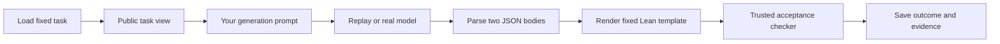

# Exercise 5 — Generate and check one LLM proposal

Exercises 1–4 passed review. This exercise introduces LLM generation for the
same fixed checked-subtraction contract. You implement two functions: the
generation prompt and the one-shot agent flow. Transport, parsing, records,
and the trusted Lean acceptance checker are supplied. No written Q&A or
reflection is required.

The first **ok** requests review. After passing feedback, another **ok** advances
to Exercise 6. Automated checks do not advance the course.

## The flow you are building



Replay supplies a saved model-shaped response; it does not generate fresh Lean
or assess prompt quality. A real run sends your prompt to the selected LLM.
Both use the same parser, renderer, checker, and records. This lesson makes one
generation attempt: a failed proof remains a failed attempt. Repair comes next.

## First task — build the generation prompt

Implement `build_generation_prompt(task)` in
[agent/prompts.py](../../agent/prompts.py). The input is an immutable `AgentTask`,
an allowlisted view supplied by [agent/task_view.py](../../agent/task_view.py).
It contains task information; it contains no repository root, metadata paths,
reference implementation, or reference proof.

The output is `Prompt(system: str, user: str)`. The `system` message describes
the solver's role and output rules. The `user` message supplies the actual task.
Both messages must be nonempty. Use the input fields instead of hard-coding
checked subtraction or reading answer files.

| Input field | What the model needs it for |
| --- | --- |
| `title`, `id` | Identify the task. |
| `implementation_type` | Required function signature. |
| `implementation_header`, `theorem_header` | Fixed declaration names and required correctness statement. |
| `specification_source` | Actual definition of the contract it must prove. |
| `template_source` | Where the two generated bodies will be inserted. |
| `permitted_imports` | Available trusted modules; the model cannot add imports. |
| `public_examples` | Public arguments/expected outputs, supplementing the formal contract. |
| `lean_toolchain` | Pinned Lean version to target. |

For example, `task.implementation_type` is the string
`Nat → Nat → Option Nat`. Each public example has `arguments`, a tuple such as
`(8, 3)`, and `expected`, a string such as `"some 5"`.
You can loop over examples to format them or use `dataclasses.asdict` and
`json.dumps`. Insert the specification and template verbatim into labelled
blocks. An f-string can insert `task.template_source` directly: braces inside
that inserted value are ordinary text.

Explain the response contract in the prompt:

- Return one JSON object with exactly `implementation_body` and `proof_body`,
  both nonempty strings, and no Markdown fences or surrounding prose.
- Supply bodies only. The renderer already supplies the imports, function
  header, and correctness theorem header. A tactic proof body starts with `by`.
- Preserve the required specification, signature, and theorem statement.
- Do not add top-level declarations, axioms, unfinished proofs, or command
  markers. The existing preflight rejects whole-word `DISALLOWED_WORDS` and
  `#`, even inside comments. The exact list and 32,768-byte UTF-8 limit per body
  are supplied in [agent/proposal.py](../../agent/proposal.py).

You may import `DISALLOWED_WORDS` and `MAX_BODY_BYTES` to describe these limits.
Do not include a completed implementation/proof, earlier learner solutions,
replay responses, or private files in the generation prompt. Reuse only the
public task view. Local `let` bindings and proof-local `have` are permitted.

Run the focused checks first; they need neither Docker nor an API key:

```bash
.venv/bin/python -m scripts.exercise05_review --only prompt
.venv/bin/python -m scripts.exercise05_run --prompt-only
```

The second command writes `runs/exercise05/prompt.json` for inspection. Initially
the first function raises `NotImplementedError`; that is the task to complete.
The tests check coverage of the supplied task information; prompt clarity and
absence of answer leakage are also part of implementation review.

## Second task — connect the one-shot agent

Implement `run_one_shot(task, session)` in
[agent/oneshot.py](../../agent/oneshot.py). Its `task` is the same public view.
Its `session` supplies all system operations:

| Operation | Input → output |
| --- | --- |
| `build_generation_prompt(task)` | Public task → your `Prompt`. |
| `session.generate(prompt)` | Prompt → completed `ModelReply`, including `.text`. |
| `session.parse(reply.text)` | JSON string → validated `Proposal`. |
| `session.render(proposal)` | Proposal → assembled Lean source string. |
| `session.check(source)` | Rendered source → authoritative `AcceptanceResult`. |

Call these in order, storing each returned value, and return the result of
`session.check`. This is a short orchestration function. The supplied entry
point loads `Task` and creates the session for you. Do not write HTTP requests,
JSON parsing, subprocesses, Docker commands, or file-saving code.

For example, `reply.text` is still JSON text. After `session.parse(reply.text)`,
`proposal.implementation_body` and `proposal.proof_body` are already extracted
strings. After `session.render(proposal)`, `source` is the complete Lean file
with the trusted surrounding declarations. Pass that source to `session.check`.

Let supplied model/format failure exceptions propagate. The outer recorder
classifies them and saves the outcome. Do not retry, strip Markdown fences,
substitute a known solution, or turn an error into claimed acceptance.

Run the seven learner tests, which use a spy checker and need no Docker/API:

```bash
.venv/bin/python -m unittest discover \
  -s exercises/05-one-shot-generation/tests -v
```

The two starter holes intentionally fail these tests until implemented.

## Replay through the actual Lean checker

After both functions pass the learner tests:

```bash
.venv/bin/python -m scripts.exercise05_run --replay valid
.venv/bin/python -m scripts.exercise05_run --replay proof_error
.venv/bin/python -m scripts.exercise05_run --replay malformed
```

The first two require the existing Exercise 4 Docker checker/image. If it needs
rebuilding, use `.venv/bin/python -m scripts.prepare_exercise04_checker`.
The third stops before Lean. Each command saves a new immutable run directory.
A single-run command returns nonzero for any outcome other than `VERIFIED`;
an intentionally bad replay therefore has a nonzero exit even when behaving
correctly. The review command labels expected failures as passing observations.

| Replay | Expected outcome | Calls to the acceptance checker |
| --- | --- | --- |
| `valid` | `VERIFIED` | 1 |
| `proof_error` | `ELABORATION_FAILED` | 1 |
| `malformed` | `INVALID_PROPOSAL` | 0 |
| `refusal` | `MODEL_REFUSED` | 0 |
| `incomplete` | `MODEL_INCOMPLETE` | 0 |
| `provider_error` | `MODEL_ERROR` | 0 |

The replay token counts are synthetic fixture values, labelled `fixture`;
they are not measurements of real model cost.

## Make one real-model attempt

Once replay works, open the repository's `.env` file and fill in these settings:

```dotenv
LLM_API_URL=https://api.openai.com/v1/responses
LLM_API_KEY=
LLM_MODEL=
```

Enter your key after `LLM_API_KEY=` and your actual accessible model ID after
`LLM_MODEL=`. The URL must be the full **Responses-compatible endpoint**,
including its `/responses` path. Custom gateways must support the same API and
strict JSON schema output; changing the URL does not translate other API
formats such as Chat Completions or Anthropic Messages. HTTP endpoints are
supported for local servers. No model is chosen implicitly.

The shared configuration loader reads `.env` from the repository root even
when called from another working directory. File values override previous
terminal exports, including when a file value is blank. Explicit `--model`
overrides only the model. If a setting is absent from the file, existing
`LLM_*`/legacy `OPENAI_API_KEY` and `OPENAI_MODEL` environment values remain
supported. Values are literal; no shell commands or variable expansion run.

`.env` is excluded from Git; [.env.example](../../.env.example) is the shareable
template. Fill in the real `.env` locally. No `export` or shell activation is
needed for model settings. Then run:

```bash
.venv/bin/python -m scripts.exercise05_run --live
```

This makes at most one provider request. The adapter uses strict structured
output and records refusals/incomplete responses separately. Structured JSON
does not establish Lean correctness. The implementation follows the
[official OpenAI documentation](https://developers.openai.com/api/docs/guides/structured-outputs?api-mode=responses).
`--max-output-tokens` defaults to 8192 and covers reasoning as well as visible
output; see [OpenAI token accounting](https://developers.openai.com/api/docs/guides/token-counting).
There are no automatic retries. The socket timeout defaults to 120 seconds;
it is an operation timeout, not a strict total request deadline. Model settings
and elapsed time are saved. Interrupted/failed requests may have unknown usage;
unknown values stay `null` rather than being recorded as zero.

The API key is loaded only into the host transport, excluded from saved requests
and prompts, and never passed to Lean workers. No live model was called during
lesson preparation. A real run may produce an unsuccessful Lean proposal; that
is valid exercise evidence. A missing key, invalid model, HTTP/API failure, or
unavailable checker still needs resolving before review can pass.

## Evidence and review

Every run under `runs/exercise05/attempts/run-*/` preserves the stages it reaches:

```text
task.json                 public task snapshot and digest
prompt.json               exact system/user messages
model.json                model, usage, outcome, timing; no credentials
provider-response.json    returned provider packet, when available
response.txt              extracted assistant text
proposal.json             validated fields, when parsing succeeds
Candidate.lean            assembled source, when rendering succeeds
acceptance/               full checker reports, diagnostics, checked artifact
result.json               final outcome, counters, settings, source hashes
```

`model_calls` counts generation operations; `provider_requests` counts HTTP
attempts (zero for replay), and `acceptance_checks` counts checker operations.
These counters do not imply that a remote request completed or that every
checker operation reached compilation. The nested checker report records its
actual stages and diagnostics. Reasoning-token counts are part of output
tokens, not an additional token total.

Run the complete check:

```bash
.venv/bin/python -m scripts.exercise05_review
```

It runs learner tests and all six replay cases, then looks for an existing real
run from your current two learner files and task digest. It never makes a paid
request. Keep live runs in the default artifact directory for this discovery.
If replay passes and live evidence is missing, the summary says so. A live
response may fail the proof or format and still demonstrate the real generation
path; provider/infrastructure/controller failures do not complete the exercise.
Review also examines the saved prompt, source, and diagnostics.

The summary is `runs/exercise05/review.json`; each review session is preserved
under `runs/exercise05/reviews/`. Say **ok** after the evidence is ready. I will
review your two functions and outcomes, give feedback, and wait for your next
**ok** before Exercise 6. There are no written-answer files to complete.
